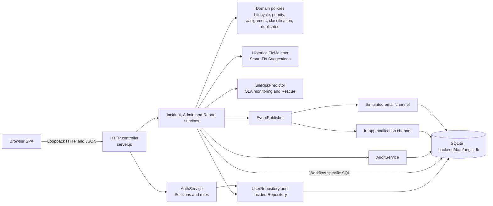

# BITS IT Support architecture

The application is a layered monolith. A JavaScript single-page application and HTTP JSON API run from the same local Node.js 24 process. Business rules sit in domain collaborators called by the services, and SQLite provides file-backed persistence.

## Boundaries and data flow

- The [browser](../../frontend/app.js) renders role-specific views and calls the API. Both the incident detail and SLA Rescue timers measure elapsed time from a server-evaluated UTC timestamp.
- The [controller](../../backend/src/server.js) parses requests, resolves bearer sessions, guards administrator routes, and maps domain errors to client-safe HTTP responses. Public registration creates employees only.
- The [services](../../backend/src/services.js) enforce incident ownership, assignment permissions and lifecycle preconditions. They write audit events for important actions. Incident creation commits the incident, assignment and audit records before publishing notifications. SLA Rescue reminder writes and both notification channels run in one transaction.
- The [domain classes](../../backend/src/domain.js) calculate priority, select technicians, validate state transitions and explain intelligence decisions. The [SQLite layer](../../backend/src/database.js) persists state and history and enforces foreign keys and uniqueness. Some use-case queries live in the services.

## Technology rationale

| Decision | Reason and trade-off |
| --- | --- |
| JavaScript with built-in Node.js modules | One language across the stack and small setup cost. Classes and runtime behavioral contracts support OOP. Java/Spring would add compile-time contracts and more tooling. |
| Native HTML and CSS | Role-specific SPA served from the API process, with no separate build pipeline. |
| SQLite | Relational integrity, transactions and restart durability in one local file. A shared relational database and a worker queue would suit a future multi-instance deployment. |
| Opaque sessions and local credentials | Salted scrypt password hashes and hashed expiring tokens support the local demo. A hosted deployment would need separate transport and identity safeguards. |
| Deterministic automation | Rules are explainable and testable using fixed clocks and fixtures. Smart Fix coverage depends on the accessible incident history. |

See the [OOP design](../OOP_DESIGN_EXPLAINED.md), [ER diagram](../diagrams/ER_DIAGRAM.md), and [schema](../database/SCHEMA.md).
