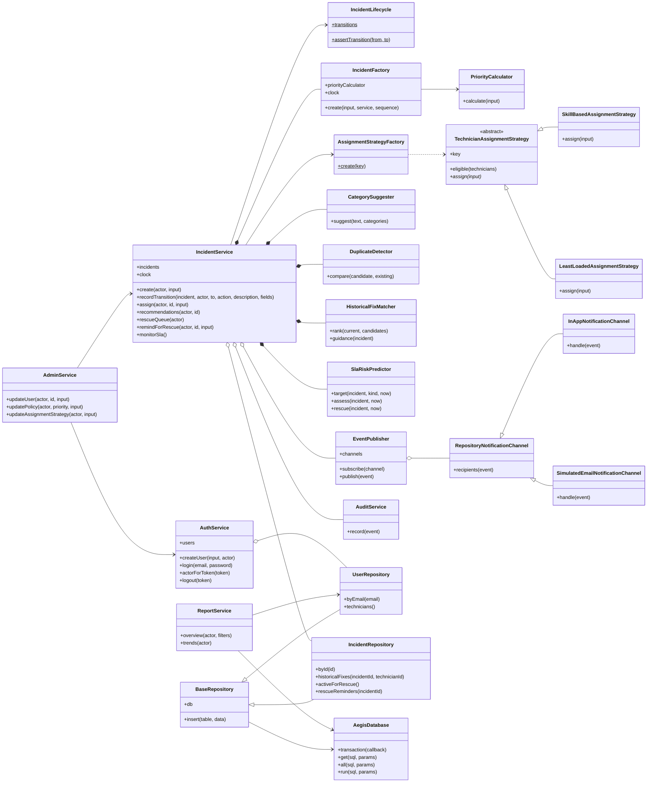

# BITS IT Support class diagram

The diagram shows selected fields and methods. JavaScript implements `assign(input)` and `handle(event)` as behavioral contracts. Domain exceptions inherit from `DomainError` and carry an HTTP status and code. See the [domain classes](../../backend/src/domain.js), [services](../../backend/src/services.js), [repositories](../../backend/src/database.js), and [data associations](ER_DIAGRAM.md).
