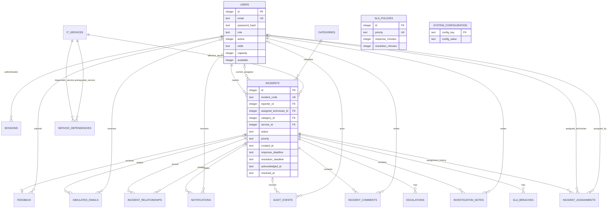

# BITS IT Support entity-relationship diagram

The diagram lists selected columns. Incident creation copies the policy's response and resolution targets into the incident. Policies and configuration have independent keys. Smart Fix uses historical incident data, and SLA Rescue reads snapshots and breach flags and stores reminder metadata in `audit_events`. See the [schema](../database/SCHEMA.md) for constraints.
