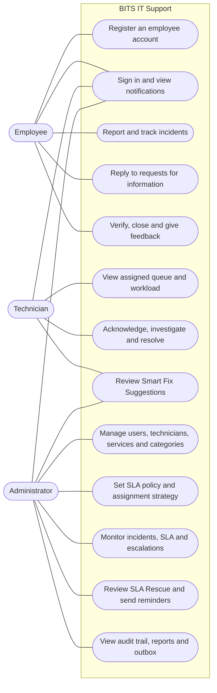

# BITS IT Support use-case diagram

Employees see their own incidents, technicians see assigned incidents, and administrators oversee all records. An administrator can also report an incident and verify its resolution as the original reporter. Authorization is enforced by the [application services](../../backend/src/services.js).
